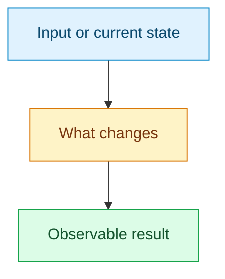

<!-- Use a concise Conventional Commit title. Replace prompts with concrete details;
remove unused diagram scaffolding. Follow lat.md/contributing.md#pull-request-format. -->

## Summary

<!-- State the outcome and why it matters in one or two sentences. -->

## Problem

<!-- Describe the concrete limitation or failure that motivated this change. -->

## Solution

<!-- Explain the final approach. Link relevant ADRs, NFRs or contracts when useful.
Show a small, relevant Mermaid infographic for flows, boundaries or relationships.
Replace this example; omit it for trivial changes where it adds no information. -->

## Scope

<!-- State affected behavior and material limits, exclusions or migration risks. -->

## Validation

<!-- List actual checks and outcomes. Distinguish local results, CI and remaining gaps.
Do not claim a passing test establishes correctness beyond its tested scope. -->

- [ ] Conventional Commit title and commits
- [ ] Formatting, lint, and applicable tests pass
- [ ] Regression test or evaluation added for changed behavior
- [ ] Lat docs, README/help, changeset, and analysis skill updated when applicable
- [ ] Actionable review findings resolved
