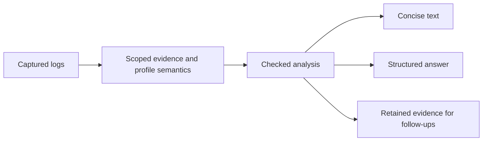

# Checked analysis design

Status: proposed implementation, following the [design philosophy](../README.md#design-philosophy).
PR #89 is closed unmerged; its branch remains available for individual fixes and tests.

## Product contract

One investigation should return a useful account of what happened, timings,
coverage and explicit unknowns. Agents choose questions and subjects; the analyzer
owns calculations, evidence addresses and consistency checks. Ordinary use requires
no checklist file, claim file, helper script or separate verification command.

Keep `log-analyzer investigate application.log` as the entry point. Default text
is concise; `--verbose` exposes diagnostics. JSON and text use the same findings.
Follow-up evidence retrieval uses the original capture, without parsing a changing
log again. Existing explicit profile selection remains available.

## One checked result

Introduce a private checked-analysis module between evidence construction and
presentation. Its interface accepts captured evidence and declared profile
semantics, then returns a checked result or an error. Renderers cannot publish
unchecked measurements. Reuse the existing relation validator and retained
evidence; do not build a second claim verifier or parallel artifact format.

Each answerable finding keeps these together:

- Subject: independent input, scoped event identity and source occurrence.
- Fact: observed outcome, interval with exact endpoints, or count with its exact
  population and completeness. Missing measurements stay absent, never zero.
- Support: stable finding ID, source citations and the rules used.
- Limits: ambiguity, missing semantics, partial coverage or unavailable evidence.

Unknowns identify the affected subject or question and the missing support.
Evidence consistency, profile validation and question coverage are separate states;
none is a universal "answer verified" flag. A consistent result about the wrong
subject must not satisfy a requested question.

## Responsibility and failure behavior

The agent supplies intended subjects explicitly when a question needs selection.
The tool returns all matching candidates when selection is ambiguous; it does not
pick the first or nearest label. Reused IDs remain separated by input and scope.

Compute counts from declared populations and elapsed time from observed, named
endpoints. A failed terminal outcome can still establish completion. Cached results,
later activity and temporal order do not establish completion or causality.
Render factual sentences from checked values; optional agent explanations must
distinguish supported observations from hypotheses.

Before presentation, validate calculations and source bindings. Invalid derived
facts fail publication. Unavailable source verification, redaction and processing
limits remain visible; they must not produce a clean or fully verified result.
Presentation truncation is separate from processing completeness. Keep unknowns
and coverage visible even when routine findings consume the display budget.

Profile adaptation is a later bounded transaction: propose, validate against
independent expectations and negative cases, then rerun. Candidate output cannot
supply its own ground truth. Unsupported semantics remain explicit unknowns.

Mandatory runner enforcement is also a later milestone. The runner owns artifact
binding and question coverage, using the native result. It rejects contradictory
structured answers and reports specific missing support within the original
budget. Arbitrary prose and arbitrary question meaning require separate assessment;
an additional model reviewer is not the source of truth.

## First implementation and acceptance

Implement the checked result and concise renderer for scoped capture/close
intervals, record counts and causal uncertainty. Preserve parsing, correlation,
source offsets, retention and existing independent-input behavior. Keep advanced
claim verification optional; do not add new CLI steps or runner protocols here.
Capture, close and poll meanings come from profile rules, not hard-coded event
names or evaluation fixtures.

Test through the CLI with independently specified expectations:

- Similar names and reused IDs across scopes select the right event or stay ambiguous.
- A terminal event, including failure, yields its exact interval; a missing end
  yields an unknown. Overlapping starts do not invent a duration.
- Poll sends, responses and cached results have separate count populations.
- Partial, malformed, redacted and empty-filtered captures disclose their limits.
- Text and JSON agree on subjects, endpoints, counts, unknowns and coverage.
- Late terminal events and findings beyond the first page remain recoverable.
- Renaming IDs or adding unrelated input cannot change another subject's answer.

Use existing synthetic evaluation cases as regressions, plus unseen formats and
multi-turn subject changes. Freeze inputs, expected facts, binaries and budgets
before comparison. Measure supported completion, false certainty, unnecessary
unknowns, latency and cost. Keep natural use and mandatory enforcement separate.
Expand only after the first slice improves useful completion without factual
regressions; paid model trials require an explicit run budget.

## Reuse from the closed experiment

Review readable-output fixes, bounded unknown reporting, safe path rendering and
their regression tests individually. Main already contains subject-bound evidence
checks. Do not import PR #89's helper orchestration, duplicated action summaries
or fixture-specific mandatory runner as the new product architecture.
