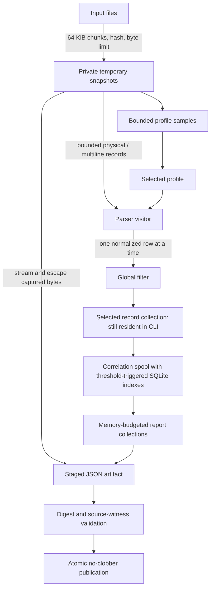

# Streaming investigation sources

The pipeline yields parsed records to a consumer. Storage is separate from parsing;
SQLite is not an artifact format or a prerequisite for consuming records.



## Implemented boundaries

- Source capture reads 64 KiB at a time, hashes the exact retained prefix, validates
  UTF-8 across chunk boundaries, and retains a 64 KiB profile sample per input.
  Capture scratch reservations are released after reading. Input byte limits bound
  temporary source disk usage; temporary files are private and automatically removed.
- The parser consumes bounded physical lines and carries the current multiline
  candidate across read boundaries. A prefix cutoff never flushes an unfinished
  record. Automatic parser detection bounds buffered sampling by physical-line
  count and accumulated bytes; blank continuations and physical addresses survive.
- `visit_log_file` emits records synchronously to a fallible callback. Returning an
  error applies backpressure immediately; no subsequent records are emitted. The
  parser does not retain a collection of emitted records. Physical/multiline record
  size is explicit. Normalization retains at most twenty diagnostics before an
  explicit error; structural diagnostics already have a bounded sample.
- Normalization holds the bounded physical JSON envelope and emits one expanded
  row at a time. This is not an incremental parser for an arbitrarily large JSON
  value: `record_max_bytes` remains the envelope limit. Row paths, physical lines,
  offsets and raw witnesses remain attached to every record.
- Investigation filters emitted records before its analysis collector and moves
  them into correlation without the previous second parsed-record clone. Discarded
  records release their reservations immediately, including expanded rows. Counts
  still describe parsing before filters. Correlation state survives all read chunks;
  a chunk ending never establishes completion or absence.
- Artifact capture data is written directly from snapshots through bounded JSON
  escaping (or a bounded byte-array writer for non-UTF-8 captures). The retained
  logical tree contains capture metadata, not complete capture strings. The writer
  enforces the artifact byte cap. A staged file is published only after source,
  identity and relational validation; failures preserve explicit unavailable status.
- Construction-time raw-witness verification walks snapshot files in source order
  with a bounded line cursor. Multiple normalized rows can revisit the same physical
  record. It does not construct an index of every line in each input.
- Retrieval hashes into a private snapshot before parsing or emitting retained
  facts. Validation borrows the parsed artifact tree. Version-1 JSON and its existing
  cursors remain compatible.

## Remaining state boundary

The investigation consumer still retains selected `LogEntry` values and calculated
report collections under its existing conservative memory budget. It emits a
partial outcome if that budget is exhausted. Pending correlation indexes now spill,
but completed results and retained report collections do not. JSON retrieval still materializes the
artifact tree. These stages do not have constant RSS, and source streaming alone
does not complete issue #86's end-to-end out-of-core requirements.

Pending correlation records and per-key summaries use append-only temporary payload
files. The resident index spills to SQLite at a fixed allowance; SQLite stores
only offsets, identities and sort keys, with a 2 MiB page cache per state store,
`mmap_size=0` and disposable journaling disabled. It is never the external artifact
format. Payload plus database page limits are checked on every append; failed
writes cannot produce a successful partial stream. Temporary directories are
removed on drop, including cancellation and consumer errors.

Correlation makes two ordered passes. The first establishes inferred-year and
whole-key overlap decisions, including late ambiguity that invalidates earlier
pairs. The second holds one pending boundary and emits zero, one or two source
records per decision. Records require unique input/line/row addresses; duplicate
addresses and inconsistent input-to-file mappings fail explicitly. A single
correlation stream owns its effective profile and is consumed by finalization.
The CLI uses this correlator, but collects its completed operations and unmatched
records for the existing report builder. The library consumer can remain bounded.

## Measurement

Build and run the synthetic yielding-consumer probe:

```sh
cargo build --release --locked --example stream-records
python3 scripts/measure-streaming-memory.py target/release/examples/stream-records
```

Every size runs in a fresh process, parses real JSONL records, checks the record
count and source digest, and records OS-reported child peak RSS. The probe consumer
counts and discards records; it measures the parser boundary, not correlation,
artifact retrieval or an end-to-end investigation. Saved results are in
[`../evals/streaming-parser-memory.json`](../evals/streaming-parser-memory.json).
For investigation state growth, use the existing
`measure-investigation-memory.py` separately; its accounting is not RSS.

The same script can exercise capture, filtering and JSON artifact publication with
zero selected records and a fixed 8 MiB accounting budget:

```sh
cargo build --release --locked --bin log-analyzer
python3 scripts/measure-streaming-memory.py target/release/log-analyzer --investigate
```

[`../evals/streaming-filtered-investigation-memory.json`](../evals/streaming-filtered-investigation-memory.json)
records that separate experiment. It verifies complete parse coverage and artifact
publication; the excluding filter means it does not exercise growing correlation
state. No input is padded with unrelated database pages.

On the recorded macOS arm64 runs, source size grew from 66,000 to 66,000,000 bytes.
The parser probe stayed below 10 MiB peak RSS; the excluding-filter investigation
stayed below 14 MiB while publishing complete artifacts. These are measured stage
results on the synthetic corpus, not a bound for retained correlation state.

### Selected correlation workload

```sh
cargo build --release --locked --example stream-correlations
python3 scripts/measure-correlation-memory.py target/release/examples/stream-correlations
```

This separate probe selects every parsed record, writes every start before any
completion, and checks exact emitted-record counts, pair counts, each duration,
source ordering, scope, and input hashes. It uses a 1 MiB resident index allowance,
two 2 MiB SQLite page caches, a 256 KiB serialized-record cap and a 4 GiB disk cap.
Every size runs in a fresh worker. The script fails above a 64 MiB absolute RSS
ceiling or a 24 MiB growth tolerance across the sweep; these are reproducible
measurement thresholds, not a cross-platform allocation guarantee.

The recorded 2,000 / 20,000 / 200,000 selected-record sweep used 13.3 / 15.6 /
14.6 MiB peak RSS and correctly completed 1,000 / 10,000 / 100,000 late pairs.
Results are in [`../evals/streaming-selected-correlation-memory.json`](../evals/streaming-selected-correlation-memory.json).
It measures the yielding parser plus real growing correlation state. It does not
measure full CLI evidence construction or retrieval, whose remaining materialized
collections still prevent an end-to-end bounded-memory claim.
