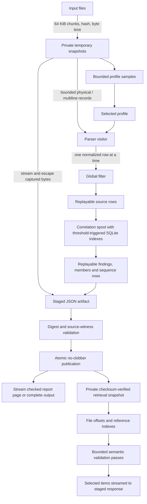

# Streaming investigation pipeline

The pipeline yields parsed records to a consumer. Storage is separate from parsing;
SQLite is not an artifact format or a prerequisite for consuming records.



## Implemented boundaries

- Source capture reads 64 KiB at a time, hashes the exact retained prefix, validates
  UTF-8 across chunk boundaries, and retains a 64 KiB profile sample per input.
  Capture scratch reservations are released after reading. Input byte limits bound
  temporary source disk usage; temporary files are private and automatically removed.
- The parser consumes bounded physical lines and carries the current multiline
  candidate across read boundaries. A prefix cutoff never flushes an unfinished
  record. Automatic parser detection bounds buffered sampling by physical-line
  count and accumulated bytes; blank continuations and physical addresses survive.
- `visit_log_file` emits records synchronously to a fallible callback. Returning an
  error applies backpressure immediately; no subsequent records are emitted. The
  parser does not retain a collection of emitted records. Physical/multiline record
  size is explicit. Normalization retains at most twenty diagnostics before an
  explicit error; structural diagnostics already have a bounded sample.
- Normalization holds the bounded physical JSON envelope and emits one expanded
  row at a time. This is not an incremental parser for an arbitrarily large JSON
  value: `record_max_bytes` remains the envelope limit. Row paths, physical lines,
  offsets and raw witnesses remain attached to every record.
- Investigation filters emitted records before writing replayable source rows.
  Correlation consumes those rows one at a time. Selected and discarded records
  release parser reservations immediately, including expanded rows. Counts
  still describe parsing before filters. Correlation state survives all read chunks;
  a chunk ending never establishes completion or absence.
- Artifact capture data is written directly from snapshots through bounded JSON
  escaping (or a bounded byte-array writer for non-UTF-8 captures). The retained
  metadata contains no complete capture strings. Private staging is bounded by
  the construction disk allowance; publication additionally obeys the artifact
  byte cap. Full source, identity and relational validation precedes publication
  and inline delivery. Actual staging failures fail closed. An artifact publication
  cap reports explicit unavailable status without skipping fact verification.
- Construction-time raw-witness verification walks snapshot files in source order
  with a bounded line cursor. Multiple normalized rows can revisit the same physical
  record. It does not construct an index of every line in each input.
- Retrieval hashes into a private snapshot before parsing or emitting retained
  facts. Temporary file indexes address JSON nodes and cross-references; bounded
  projections reuse the contract validator, with separate global membership,
  uniqueness, ordering and calculation checks. Version-1 JSON and its existing
  cursors remain compatible.

## Analysis and report state

Selected source rows and completed correlations are stored in plain temporary files
with fixed-width on-disk ordinal indexes. Selection and capability checks replay
records and use bounded file indexes; they do not retain a whole source vector.
Policy, chain, resource and scope-identity joins keep a small resident key index and
spill only that index when necessary. Single atomic witness bundles remain capped;
large scope-identity witness groups produce bounded context findings with exact
witness counts. No chunk boundary establishes completeness or causality.

Membership rows, sequence events and stable-priority finding buckets are replayed
into the v1 artifact. Distribution sample IDs stream separately, and exact samples
and event order use external radix sorts. Final snapshot binding and redaction are
applied per item; membership digests cover the exact final serialized array.
The staged artifact undergoes the bounded semantic validator before publication.
Report pages and complete text/JSON are staged and streamed; presentation budgets
count exact UTF-8 bytes and Unicode scalars. Compact assessment references retain
checked evidence even when a page displays zero findings.

The shared construction row/sort/private-artifact allowance defaults to 4 GiB. Key
indexes and artifact validation have separate finite storage/work allowances. Validation uses
at least 180 seconds and 500 million work units to permit checked partial reports
after analysis runs out of budget. These are finite resource limits, not a promise
that arbitrary inputs can complete. No full-input proof is inferred from partial
coverage, unsupported semantics, or ambiguous identity.

Pending correlation records and per-key summaries use append-only temporary payload
files. The resident index spills to SQLite at a fixed allowance; SQLite stores
only offsets, identities and sort keys, with a 2 MiB page cache per state store,
`mmap_size=0` and disposable journaling disabled. It is never the external artifact
format. Payload plus database page limits are checked on every append; failed
writes cannot produce a successful partial stream. Temporary directories are
removed on drop, including cancellation and consumer errors.

Correlation makes two ordered passes. The first establishes inferred-year and
whole-key overlap decisions, including late ambiguity that invalidates earlier
pairs. The second holds one pending boundary and emits zero, one or two source
records per decision. Records require unique input/line/row addresses; duplicate
addresses and inconsistent input-to-file mappings fail explicitly. A single
correlation stream owns its effective profile and is consumed by finalization.
The CLI consumes decisions into replayable completed-operation and unmatched-event
rows. Library consumers may process decisions directly.

## Measurement

Build and run the synthetic yielding-consumer probe:

```sh
cargo build --release --locked --example stream-records
python3 scripts/measure-streaming-memory.py target/release/examples/stream-records
```

Every size runs in a fresh process, parses real JSONL records, checks the record
count and source digest, and records OS-reported child peak RSS. The probe consumer
counts and discards records; it measures the parser boundary, not correlation,
artifact retrieval or an end-to-end investigation. Saved results are in
[`../evals/streaming-parser-memory.json`](../evals/streaming-parser-memory.json).
For investigation state growth, use the existing
`measure-investigation-memory.py` separately; its accounting is not RSS.

The same script can exercise capture, filtering and JSON artifact publication with
zero selected records and a fixed 8 MiB accounting budget:

```sh
cargo build --release --locked --bin log-analyzer
python3 scripts/measure-streaming-memory.py target/release/log-analyzer --investigate
```

[`../evals/streaming-filtered-investigation-memory.json`](../evals/streaming-filtered-investigation-memory.json)
records that separate experiment. It verifies complete parse coverage and artifact
publication; the excluding filter means it does not exercise growing correlation
state. No input is padded with unrelated database pages.

On the recorded macOS arm64 runs, source size grew from 66,000 to 66,000,000 bytes.
The parser probe stayed below 10 MiB peak RSS; the excluding-filter investigation
stayed below 14 MiB while publishing complete artifacts. These are measured stage
results on the synthetic corpus, not a bound for retained correlation state.

### Selected correlation workload

```sh
cargo build --release --locked --example stream-correlations
python3 scripts/measure-correlation-memory.py target/release/examples/stream-correlations
```

This separate probe selects every parsed record, writes every start before any
completion, and checks exact emitted-record counts, pair counts, each duration,
source ordering, scope, and input hashes. It uses a 1 MiB resident index allowance,
two 2 MiB SQLite page caches, a 256 KiB serialized-record cap and a 4 GiB disk cap.
Every size runs in a fresh worker. The script fails above a 64 MiB absolute RSS
ceiling or a 24 MiB growth tolerance across the sweep; these are reproducible
measurement thresholds, not a cross-platform allocation guarantee.

The recorded 2,000 / 20,000 / 200,000 selected-record sweep used 13.3 / 15.6 /
14.6 MiB peak RSS and correctly completed 1,000 / 10,000 / 100,000 late pairs.
Results are in [`../evals/streaming-selected-correlation-memory.json`](../evals/streaming-selected-correlation-memory.json).
It measures the yielding parser plus real growing correlation state. It does not
measure full CLI evidence construction or retrieval. Retrieval has a separate
selected-record sweep below; the end-to-end investigation sweep includes report
construction and complete delivery.

## Bounded artifact retrieval

The retained format stays version-1 JSON. Every request copies and hashes a private
immutable snapshot before validation, then builds 64-byte JSON offset entries in a
temporary file. Navigation and exact finding-ID lookup use offsets; strings and
large arrays remain in the snapshot. Reference maps use fixed on-disk hash slots
and exact key comparisons, without mmap or SQLite. No persistent cache or format
migration is required; old readers still read the same JSON. This trades additional
temporary I/O and a full verification pass per request for compatibility and bounded
working memory. It does not promise constant-time retrieval from an unverified file.

Records are checked in chunks of at most 128 (about 1 MiB, plus one bounded item).
Memberships, sequences, assessments and distribution sample IDs are visited one at
a time. Global uniqueness, exhaustive membership hashes, source dependencies,
scope, sample ownership and event order use disk indexes. The existing contract
validator checks bounded projections against actual retained witness records;
checks that depend on the full collection run separately. In particular, a projected
empty population never becomes a new absence claim. Exact mean calculation uses
four external radix passes with a 512 KiB histogram to preserve the legacy sorted
floating-point summation order. Original source hashes are cached only for private
snapshots; raw-record verification is cached by the exact record digest. Redacted
stored bytes never establish original-source availability.

The default item/metadata/witness allowance is 8 MiB. JSON offset disk usage is
capped at 1 GiB. Validation/reference state has a 2 GiB allowance divided into
sixteen shares; fewer than sixteen indexes are live at once, but an individual
index can exhaust its share before the total allowance. Structural limits include
128 nesting levels, 64 KiB object keys/reference keys, 32 captured inputs, 128 root
fields and 1,024 fields per indexed record/finding/population. A 180-second
cooperative deadline and 500-million work allowance bound validation; blocking
filesystem operations and one bounded JSON operation can overshoot the deadline.
Use the `--artifact-max-*` flags documented in CLI help to adjust applicable limits.

The private snapshot plus decoded sources require at most twice the artifact read
allowance. Page payload scratch is capped at the larger of 16 MiB or eight times
that allowance, with a second staged delivery copy. These are separate disk
allowances from the offset and validation indexes. Captures and output are copied
through bounded buffers. `--complete-output` spools items instead of collecting a
page in RAM. Nested `/memberships/N/members` and `/sequences/N/events` remain usable
when their parent array is too large to return as one atomic item. Validation or
storage failures return no verified page and publish no destination file. Temporary
files are removed on drop; requested output uses atomic no-clobber publication.

### Selected artifact retrieval workload

```sh
cargo build --release --locked --bin log-analyzer
python3 scripts/measure-artifact-retrieval-memory.py target/release/log-analyzer
```

The generator selects every record and completes all starts only after the last
start. Generation uses a larger processing allowance and is **excluded** from the
retrieval RSS measurement. Each fresh retrieval child either returns every selected
record with `--complete-output` or looks up an exact measurement ID. The harness
compares every returned item to the artifact, checks selected/pair counts and source
hashes, and enforces a 64 MiB RSS ceiling with 24 MiB growth tolerance across sizes.
The measured process uses fixed 8 MiB item and 2 GiB index/state allowances. Raw
results are saved in
[`../evals/streaming-selected-retrieval-memory.json`](../evals/streaming-selected-retrieval-memory.json).
These are measured synthetic thresholds, not an OS-enforced RSS ceiling.

Subject-bound claims use a bounded projection of explicitly referenced pointers and
findings, preserving their original array indices for requirement/endpoint checks.
Referenced evidence shares an 8 MiB allowance (or the smaller item allowance), and
claim observations/drafts are capped at 8 MiB. Distinct-record and operation-filtered
counts visit one record at a time with an on-disk identity index. Draft generation
and workflow summaries scan findings incrementally; they retain bounded candidate
assertions and gap samples with exact omission counts. No claim path reconstructs
the complete artifact tree.

The recorded retrieval sweep used 1,000 / 5,000 / 20,000 selected records in
approximately 5 / 25 / 100 MiB artifacts. Across complete-record delivery, exact
measurement lookup and operation-filtered claim counts, peak RSS stayed between
8.5 and 11.2 MiB. The largest requests took 140 seconds or less on this run;
validation time still grows with artifact size.


## End-to-end selected investigation memory

Run the complete investigation process (including artifact construction,
validation, publication, and report delivery) with all source records selected:

```sh
python3 scripts/measure-selected-investigation-memory.py target/release/log-analyzer
```

The benchmark enforces a 96 MiB RSS ceiling and 24 MiB growth allowance under
fixed processing budgets. These are regression thresholds, not a cross-platform
OS memory guarantee. Use
`--baseline` only to record the existing failure without enforcing RSS thresholds;
all evidence and completion assertions still run.

The recorded baseline uses 1,000 / 5,000 / 20,000 selected records, with every
start before every completion. Default-page RSS was 56.3 / 240.1 / 824.7 MiB;
complete-output RSS was 59.5 / 240.2 / 833.8 MiB. Every run completed and retained
all selected records and pairs. Fixed input, processing, record, correlation, and
artifact limits apply at every size. Each measurement launches a fresh CLI child
before allocating expected-artifact trees. This includes construction and
validation, unlike the separate retrieval probe.

The harness checks exact physical record order and contents, input and artifact
hashes, exact start/end pairing, source timestamp offsets, measured durations,
distribution sample counts, and complete-output finding equality. Results:
[`../evals/streaming-selected-investigation-memory-baseline.json`](../evals/streaming-selected-investigation-memory-baseline.json).
Acceptance requires passing without partial processing, with all selected evidence
and complete-output findings preserved.

The completed pipeline passes the same sweep and thresholds. Default-page RSS is
15.3 / 16.0 / 17.4 MiB; complete-output RSS is 16.1 / 16.0 / 20.4 MiB. Every run
completes with all selected evidence intact. Raw results, platform and executable
hash are in
[`../evals/streaming-selected-investigation-memory.json`](../evals/streaming-selected-investigation-memory.json).

This memory reduction has a material latency cost. Default pages take 5.2 / 26.1 /
89.6 seconds, compared with 0.3 / 2.0 / 14.1 seconds in the baseline. Complete
output takes 4.6 / 24.8 / 102.2 seconds, compared with 0.3 / 2.7 / 15.0 seconds.
Both sweeps use the same selected corpus and configured processing budgets; the
new implementation performs more temporary I/O and bounded validation passes.
These are single-run synthetic measurements, not a latency distribution or a
real-agent cost estimate. Model-token cost and arbitrary prose accuracy are not
measured by this probe.

### Selected chain and relationship construction

```sh
python3 scripts/measure-chain-construction-memory.py target/release/log-analyzer
```

This additional end-to-end probe grows 100 / 500 / 2,000 chain roots, with three
selected source records per root and complete output. Two interleaved sessions
reuse IDs. The fixture declares the intended joins; independent assertions bind
every link to its expected source lines, scope and exact 1,000 ms interval. The
probe also checks every retained record, source timestamp offsets, population
membership, later-activity counts, omission counts and complete finding equality.
An endpoint interval explicitly does not establish causality or operation duration.

Each size runs in a fresh child with fixed record, correlation, construction and
processing allowances. Expected report trees are loaded only after the measured
child exits. The same 96 MiB absolute RSS and 24 MiB growth thresholds apply. This
is a synthetic deterministic regression, not a real-agent evaluation or evidence
that a generated profile can validate its own semantics.

The recorded sweep passes at 18.2 / 18.6 / 19.6 MiB peak RSS and 3.0 / 10.9 /
53.0 seconds. The largest run verifies 6,000 selected records, 4,000 exact chain
links and 2,000 scoped relationships, with all population memberships and complete
findings retained. Raw measurements and the same executable hash as the selected
correlation/report sweep are in
[`../evals/streaming-chain-construction-memory.json`](../evals/streaming-chain-construction-memory.json).
