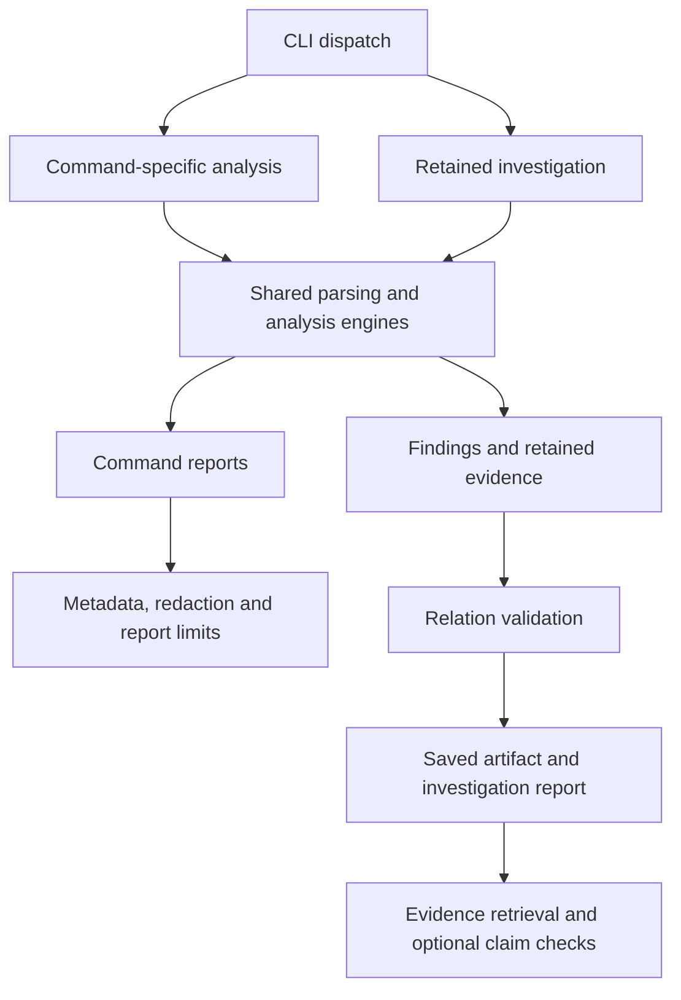

# Architecture

The Rust CLI shares parsing and analysis engines across command-specific reports and retained investigations. This page describes the implementation; [[checked-analysis]] is a separate proposal.

Architectural commitments live in [[architecture-decisions]]; their measurable
quality targets and verification scope live in [[non-functional-requirements]].

## Command routing

[[src/lib.rs#run]] selects the execution path. [[src/cli.rs]] owns argument parsing and output defaults; [[src/main.rs#main]] reports runtime errors.

Command-specific handlers compose search, extraction, comparison, errors, timeline
and performance analysis. [[src/output.rs#OutputGuard]] supplies their CLI-scoped
metadata, redaction and bounded JSON delivery. Standalone library formatters do
not load this output context. Investigations use their own artifact and presentation
path, so changing one renderer does not automatically change the other.

## Parsing and analysis

[[src/parser.rs#parse_log_file_report]] and [[src/parser.rs#parse_capture]] share the parser; the latter adds processing budgets over captured bytes.

[[src/normalize.rs#visit_normalized]] expands configured JSON rows and preserves
locations. The parser caches [[src/event_rules/mod.rs#ClassifiedRecord|classification]]
on each record. [[src/perf_analyzer/mod.rs#analyze_performance_checked]] correlates
those records; [[src/timeline.rs]] analyzes configured timeline boundaries.
[[src/filter]] supplies record selection. [[domain]] defines the distinctions
between records, events, operations and occurrences.

## Retained investigations

[[src/investigation_runtime.rs#investigate]] coordinates capture, profile selection, parsing, findings, validation, persistence and rendering under [[src/processing.rs#Budget|processing limits]].

[[src/investigation_runtime/findings.rs#build]] produces lifecycle findings;
[[src/investigation_runtime/chains.rs#calculate]] adds configured event chains.
[[src/investigation_policy.rs#InvestigationPolicy|Policy-driven populations]],
[[src/investigation_runtime/resource_observations.rs#analyze|resource observations]]
and [[src/investigation_runtime/findings.rs#observed_levels|severity counts]] remain
separate analyses.
Exact serialized artifact bytes pass [[src/investigation.rs#validate_relations]]
before publication to a new file. Failed persistence removes reusable-artifact
guarantees; presentation limits are reconciled and the report is checked again.

[[src/investigation_runtime/artifact.rs#retrieve]] checks the supplied digest and
relations before reading retained collections. It does not reparse current logs;
checking current originals is an explicit operation. Optional
[[src/investigation_runtime/claims.rs#verify|claim verification]] checks supplied
assertions and checklist coverage. It does not judge unrestricted prose.
See [[contracts/investigation-contract]] for the wire contract.

## Profile lifecycle

[[src/config.rs#AnalyzerConfig]] joins parser, normalization, event, timeline, investigation and view configuration. Inheritance is resolved before analysis.

[[src/investigation_runtime/auto_profile.rs#detect]] probes bounded captured samples
for grammar selection. [[src/profile_resolution.rs#resolve]] is the separate
suitability-based resolver. [[src/profile_preparation.rs#run]] saves editable
candidates without activating them; [[src/profile_validation.rs#analyze]] checks
sample classifications, timing and supplied expectations using the shared engines.
Selection and independent semantic validation are distinct; see [[profiles]].

## Delivery and evaluation

[[src/report_budget.rs#Policy]] bounds command JSON; [[src/investigation_runtime/artifact.rs#present]] bounds retained reports. Both expose omissions and cursor bindings.

[[src/investigation_runtime/presentation.rs]] renders readable investigations;
[[src/investigation_runtime/guidance.rs]] creates their brief and next actions.
[[schemas]] publishes machine-readable contracts through [[src/build_info.rs]].
[[regression-tests]] links key executable invariants. [[evals/run.py]] and
[[evals/native_workflow.py]] exercise broader workflows; [[evaluation]] records
protocols and limits. Model adapters live outside the analyzer binary.
