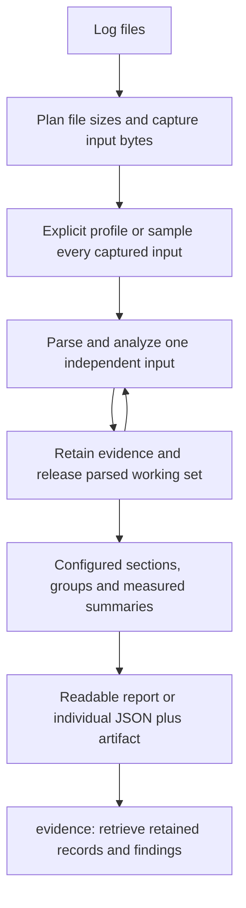

# Investigation guide

Install Log Analyzer, choose an investigation and retrieve evidence within explicit limits. Commands run from the repository root unless stated otherwise. See [[philosophy]] for design principles.

## Installation

Building from source requires Rust 1.89 or newer.

```bash
# Auto-detect platform and install latest release
curl -fsSL https://raw.githubusercontent.com/eirenik0/log-analyzer/main/scripts/install.sh | bash

# Or build from source
cargo install --path .

# Verify installation
log-analyzer --version
```

## Choose a command

Start with `investigate` for failures, timing, or an unfamiliar capture.

It detects
profiles and reports coverage, supported goals, and the next evidence to retrieve.
A profile is either built in or loaded from TOML; select either with `--profile`.
No agent skill is required to navigate the CLI.

```text
investigate   Investigate logs with automatic profile detection
evidence     Retrieve evidence from a saved investigation
profile      Prepare, validate, resolve, and manage profiles
compare      Compare two captures
search       Find matching records
capabilities Describe the machine-readable interface
```

Use `log-analyzer profile --help` for `prepare`, `validate`, `resolve`, and
`mappings`. Create new profiles through `profile prepare`; it saves an editable
candidate and reports validation gaps without activating it.

`log-analyzer --help-advanced` reveals `info`, `errors`, `perf`, `trace`, `schema`,
`extract`, and `process`. All existing spellings continue to work, including
`investigation-evidence`, `prepare-profile`, `validate-profile`, `resolve-profile`,
`profile-mappings`, `generate-config`, `diff`, and `llm-diff`; compatibility commands
are omitted from primary help. `generate-config` returns a JSON object containing TOML by default;
`--format text generate-config` retains the raw TOML export. New guidance uses `evidence` and grouped `profile` commands.

## Unified investigation and retained evidence

Start with a normal log file or several independent captures:

```bash
log-analyzer investigate application.log
log-analyzer investigate captures/*.log
```

The default output explains processing completion, per-file coverage, observed
ERROR/WARN records, supported measurements and assessment limits. A fresh local
`log-analyzer-evidence-*` directory stores `evidence.json`; its path and SHA-256
appear at the end. With `--redact`, an automatically created artifact keeps a safe
relative handle that can be used from the investigation directory; private parent
paths, profile fingerprint labels and rule names are omitted. The printed `Next`
command quotes artifact paths for a POSIX shell and includes the continuation cursor.
Severity evidence is retained within processing budgets: unavailable parsing does
not establish zero errors or warnings, and interrupted counts are partial.
Profile fingerprint matches appear before source warnings and
empty manifests; ordering highlights evidence without claiming a root cause.
Readable output uses the profile's optional `investigation_view` to organize
processed findings into sections: for example, resource observations by component
and viewport, followed by performance by component. Configuration selects findings,
group dimensions and measured summaries; the core has no application-specific
grouping rules. Each independent capture remains separate. Missing dimensions and
measurements stay unknown. At most 20 groups appear across sections, with explicit
omissions and representative citations. Individual JSON findings, measured values,
evidence references and pagination remain available without grouping.
Before the configured groups, the initial text report shows ERROR/FATAL counts
and up to three distinct, cited source-message samples for each input containing
errors in its selected parsed population. Readable excerpts and grouping values
escape Unicode control characters; JSON and retained evidence preserve the original
text. This overview reads all processed
findings before pagination, so repeated observations cannot push every error
sample onto a later page. Additional distinct messages are explicitly omitted;
source severity does not prove operation failure or cause. Individual JSON order
and continuation cursors are unchanged.
When findings are omitted, the printed `Next` command includes
a continuation cursor to retrieve the following page. Use `--artifact PATH` to choose a new destination. Existing
artifacts are never replaced. For agents, request JSON explicitly:

```bash
log-analyzer --profile examples/investigations/profile.toml investigate \
  examples/investigations/slow.jsonl --artifact evidence.json --json --report-max-items 5
log-analyzer evidence evidence.json \
  --expected-sha256 <artifact.stored_sha256> --collection /findings --report-max-items 5
```

`--summary` selects a concise JSON decision brief with up to five findings. JSON presentation budgets
also imply JSON. `evidence` always returns JSON; `investigation-evidence` remains
an alias for existing automation. Investigation captures, parses/classifies and
correlates each independent input once; bounded profile discovery samples the immutable captured bytes. Retrieval reads only the retained artifact.



Profiles can also declare connected event chains in `[[investigation.chains]]`.
These appear first in readable and JSON findings, in source order within each
input. Each step names its event type, preceding step, exact join fields and scope,
cardinality, observed candidate count, supported linked count and ambiguity. Poll
sends and responses are separate roles; acceptance, capture completion and check
completion are distinct steps. A check's `asExpected: false` and a session's
`Passed` remain independent outcomes with their own citations and level labels.
A missing recognized completion is an observation about processed evidence, never
proof of a hang or of upstream absence.

Run the small synthetic capture example:

```bash
log-analyzer --profile examples/investigations/chains/profile.toml investigate \
  examples/investigations/chains/events.jsonl --artifact chains.json
```

It shows submission, broker acceptance, poll sends, an unobserved capture end,
check/session outcomes and contrary evidence. The regression fixture also checks
321 sends with zero responses. Retrieve a complete chain bundle through `evidence
chains.json --expected-sha256 HASH --collection /findings --id FINDING_ID`; reuse
the exact checksum and finding ID from the report. Normal report limits and
continuation cursors apply to chains as whole findings.

Each chain's bundle retains first/last linked occurrences per role, up to two
additional distinct outcome values, up to two ambiguous candidates, and the last
three selected same-context records after its last linked event in parser order,
including later expanded rows on the same physical source line.
Omission counts disclose additional linked/outcome/later records; retrieve retained
records when the bundle is insufficient. Terminal and contrary roles must be
configured explicitly. Later activity has a separately declared, potentially
broader context identity and does not complete an earlier capture. Missing root
context fields make context analysis unavailable and the chain partial;
supported joins remain available. Filters and
processing limits also bound the bundle. Redaction masks nested excerpts,
identities, profile labels and outcome values.

Roles require existing event rule IDs, optional exact scalar `select` conditions
(`field`/`equals`) and an optional bounded `message_pattern`. Fields support
`event.*`, `payload.*`, structured fields, `component`, `component_id` and `level`.
The profile example documents a graph whose `from` is `$root` or a preceding step
ID. Join fields are compared exactly with every declared `scope_fields` value;
missing identities, self joins and unsupported cardinality never become guessed
links. Chain keys use the same canonical scalar identities as policy joins: numeric
`1` and string `"1"` match, while null, objects and arrays do not form keys. Cited
values retain their original types. Roots and first/last role witnesses preserve
parser expansion order when multiple rows share a physical line.
Up to eight chain declarations with sixteen steps each are supported.
`context_fields` must include every scope field. The optional
`component_id.prefix:PREFIX` selector retains the path through the first matching
segment; batched ` & ` paths qualify only if all branches yield the same path.
The shipped profile uses this to connect checkpoint activity across components
while excluding batches spanning different checkpoints. All domain meaning stays
in profile configuration. Checkpoint roots and ends use structural check/eyes
identity instead of requiring the component label `core-ufg`; `core-002` and
classic component labels can qualify with the same scope boundaries.
`component_id.ends_at_first:PREFIX` returns a boolean only when the prefix path
is unambiguous, and is true when every branch ends at that first matching segment.
The shipped roots use it to exclude nested environment/base checks. Repeated
outer roots remain ambiguous; no time-based reassignment is performed.

The shipped profile recognizes NML `Request "takeScreenshots" called` and
finished events, broker POST acceptance, and polling sends/responses by request
path, endpoint and attempt number. Acceptance and capture completion remain
separate; an unanswered poll does not become a response. Command and normalized
structured screenshot events remain supported. Close endings are retained
independently of check completion; check `asExpected` and session `status`
outcomes remain separate levels.

For validated field-name bridges, `coalesce:FIELD_A|FIELD_B` supplies the single
nonempty scalar value present at those selectors. Conflicting values remain
unavailable; it does not pick a preferred key. For example,
`coalesce:payload.resource|payload.resources.0.resource` can join a resource
record to a render record with the same explicit identifier. Scope fields and
cardinality still apply, and independent positive/negative witnesses are required.
Direct relationships resolve join and required-scope selectors with the same
implementation as chains, including `event.*`, structural component prefixes and
explicit coalesced field bridges.

Each step reports `recognition`: rule matches, exact selector failures and role
matches across the selected classified input. Zero linked steps with matching
roles indicate a join/predecessor gap, not absent activity. Zero role matches
can mean a format difference or an optional operation absent from this input.
`inspect_relationship_coverage` guidance calls for source inspection and,
where justified, independent candidate validation and explicit rerun.

Each sampled join includes `endpoint_interval`, with named source/target
operations, explicit timestamps preserving offsets, and milliseconds calculated
by the analyzer. Ambiguous populations, assumed timestamps, negative intervals
and out-of-range arithmetic are unavailable. These are intervals between the
cited endpoints; they establish neither causality nor an operation duration
unless those endpoints are its actual lifecycle boundaries.

The resource-cache evidence chain associates explicit Forbidden/Not Found
observations with same-URL cache records within the same full session path,
including INFO records and later checkpoints. It does not infer a fresh fetch,
cache contents, or visual impact. Other sessions and different URLs are excluded;
first/last evidence samples and omission counts still apply.

A configured chain with no matching root reports an unknown recognition gap,
including root rule IDs, failed exact selectors and message-pattern counts.
Selector counts are independent, not disjoint populations. Complete parsing is
separate from relationship coverage; roots missing identity/scope remain excluded.
These structural tests
make no claim about model rankings or explanation quality.

To organize a profile's measurements like the `perf` component view, add:

```toml
[investigation_view]
source_fields = ["component", "event.name", "actor_kind"]

[[investigation_view.groups]]
id = "component-performance"
title = "Performance by component and operation"
select = [{ path = "/kind", equals = "measurement" }, { path = "/details/unit", equals = "ms" }]
by = [
  { label = "Component", path = "/evidence/0/fields/component" },
  { label = "Operation", path = "/evidence/0/fields/event.name" }
]
max_groups = 12
measurements = [
  { label = "Mean elapsed", path = "/details/value", unit_path = "/details/unit", unit = "ms", aggregate = "mean" },
  { label = "Max elapsed", path = "/details/value", unit_path = "/details/unit", unit = "ms", aggregate = "max" }
]
```

Selectors are ANDed exact scalar comparisons at JSON pointers in each finding.
Dimensions can reference any finding field; `source_fields` projects up to eight
named source fields into evidence excerpts. Native `component`, `component_id`,
`level` and offset-preserving `timestamp`, classified `event.*` semantics, and
arbitrary structured fields such as `actor_kind` are supported. Evidence index 0
selects that finding's first cited record, not every record in a component.
An optional dimension `template`, such as `"{/width}x{/height}"` for a viewport
object, formats relative JSON pointers without changing the full grouping key.
Section order follows configuration; up to eight definitions, eight dimensions
and four measurements per definition are allowed. `max_groups` is 1–20, subject
to the 20-group overall limit. Missing and oversized dimensions form an explicit
unknown group within their capture.

Aggregates support `min`, `max`, `mean` and `sum` of finite numeric values whose
reported unit matches exactly. They report measured and unavailable counts;
missing values never become zero. Counts are findings, sections may overlap, and
summed elapsed intervals are not a critical path or CPU time. Groups summarize
the processed population before individual pagination, so their counts may exceed
the current page. Remove `investigation_view` to retain the individual text view.
If artifact storage fails, text retains individual findings for direct inspection.
Redacted output clears projected source fields and hides configured titles, labels
and templates; measurement units use a generic display label.

Source severity counts and representative ERROR/FATAL/WARN/WARNING excerpts remain
visible even when the profile cannot classify domain outcomes. A severity record
is an observation, not a proven operation failure or causal diagnosis. Unknown or
unparsed evidence never becomes a clean-result claim.

Profiles can declare `[[resource_observations]]` rules for scoped resource joins,
geometry and known fingerprints. Investigation applies the selected profile's
rules automatically; no domain-specific CLI switch is needed. Message markers,
identity fields/prefixes, payload paths and fingerprint labels live in TOML.
Unique ownership is required; missing or conflicting hashes remain unknown.
Viewport observations and resets are scoped by both namespace and owner, even
when the configured owner segment precedes the namespace segment.
Resource batches with an explicit owner contribute hashes and citations only to
that owner's manifest. Namespace-only batches remain eligible when the manifest
has a unique owner. Normalized resource citations retain each distinct row path,
even when several rows share one physical line; repeated references to the same
row are deduplicated.
A fingerprint match is a profile-declared observation and does not establish
rendered content or root cause. Empty manifests do not prove absent content.

For an agent's first call, use the concise capability and investigation summaries:

```bash
log-analyzer capabilities --summary
log-analyzer investigate /absolute/capture.jsonl --project-root /absolute/project \
  --summary --artifact /absolute/new-evidence.json --report-max-items 5
```

The summary contains profile provenance, processing/parse coverage, per-goal support,
up to five findings, artifact bindings and `guidance.next_actions`. Its retrieval
arguments resume after the displayed findings. If artifact retention fails,
available partial findings remain inline. Retrieve cited records before drawing conclusions. Full reports retain their existing
contract and provide guidance that resumes after displayed findings. Full
`capabilities` still supplies all schemas, including `investigation_brief` and `command_summary`.

Guidance distinguishes profile ambiguity, discovery failures, processing cutoffs,
unavailable artifacts and terminal-evidence checks. Actions with `argv: null`
describe required inputs; they are not executable commands. Redaction preserves
safe guidance and withholds path-bearing arguments. Impossible presentation budgets
remain explicit as `mandatory_metadata_over_budget`; processing budgets are separate.

Establish the project root once and pass it across investigation/resolution calls.
`--project-root` defaults to the current directory. Default discovery uses
`ROOT/config`; a relative `--profiles-dir` is relative to that root. Input paths,
explicit `--profile` paths and artifact destinations still use the working directory.
No ancestor search or directory guessing occurs. Inspect saved choices using
`profile mappings --project-root ROOT inspect`, then revalidate through
`profile resolve --project-root ROOT` with current independent assertions before
selecting the profile explicitly. Bare investigation does not activate mappings.

Capture each independent input once, detect its profile when needed,
then parse/classify and correlate the captured input once. Inspect
calculated findings, source boundaries, explicit populations and per-goal support:

```bash
log-analyzer --profile examples/investigations/profile.toml investigate \
  examples/investigations/slow.jsonl --artifact evidence.json --report-max-items 5
log-analyzer evidence evidence.json \
  --expected-sha256 <artifact.stored_sha256> --collection /findings --report-max-items 5
```

Goal support and semantic coverage describe the exact-selected population. Empty
selection has no supported lifecycle assessment; unrelated orphans and scope aliases
do not downgrade selected pairs. Outcome counts require a rule applicable to selected
records. Policy `payload.*` selectors share extraction semantics: decoded payloads
have precedence, with per-field envelope fallback and nested paths.

The main report's `retrieval.next_cursor` resumes `/findings` through
`evidence --report-cursor ...`. Retrieve `/records`, `/populations`,
`/memberships`, `/memberships/N/members`, `/sequences` or `/sequences/N/events` for
specific evidence; `--id` selects an exact retained ID/reference ID. Retrieval
binds the artifact checksum, input snapshot, effective profile/query, redaction
and collection/ID selector. It never parses or correlates sources again. Optional
`--verify-sources` hashes current files separately and reports unchanged, changed,
missing or unavailable. Prefix verification compares only consumed bytes and reports
`prefix_unchanged`, `prefix_changed` or `prefix_shortened`; retained facts stay about the captured
snapshot. Every declared input receives a verification result; unread sources are
unavailable because no retained snapshot exists. Artifact reads and optional source
verification have byte limits.
Artifacts stay local until deleted, are never overwritten and need caller-managed
retention. Retrieval saves only new `--output` files.

Bare `investigate` automatically checks built-ins and TOML profiles discovered
recursively in `ROOT/config` (the working directory unless `--project-root` is supplied). `--profiles-dir DIR`
replaces that directory. Detection uses captured prefixes: at most 128 physical
lines and 64 KiB per input, sharing a 256 KiB total sample allowance equally across inputs. Exactly one matching profile, with lifecycle or configured resource
evidence in every nonempty input and no observed parsing/classification loss, is
selected. Profiles can set `[profile].detection_requires_session_scope = true`
to require lifecycle evidence with a component-ID segment matching their configured
session prefixes; built-in domain and starter profiles use this to distinguish
shared lifecycle wording. Overlapping grammars without distinguishing scope,
mixed profiles, unknown formats and insufficient evidence fall back to generic
`base`; the highest match count never breaks a tie. Detection is sample-based
inference, not independent validation or proof of completion. Unsampled content may
differ, so inspect full-analysis coverage and per-goal support.

A **profile** defines parsing, normalization, lifecycle and correlation rules.
It can be built in or stored in a TOML **profile file**. Select either through the
global `--profile NAME_OR_FILE` option (or `LOG_ANALYZER_PROFILE`):

```bash
log-analyzer --profile eyes info logs/app.log
log-analyzer --profile ./config/team.toml info logs/app.log
```

Exact built-in names select built-ins; all other values are file paths, resolved
from the working directory. Use `./eyes` for a file named `eyes`. File profiles keep
`extends` inheritance. `--config FILE` and `--preset NAME`, including their existing
environment variables, remain hidden compatibility aliases with their original meanings. CLI help and
current examples show only `--profile`.
Selectors are mutually exclusive, including selectors supplied by environment
variables. `capabilities.profiles` advertises the unified option and built-in names;
the legacy capability and persisted JSON keys remain compatible.

Use `--profile` to override and bypass detection; `--profile base` keeps
inspection generic. Invalid explicit profiles remain errors. Detection never
rereads log sources or loads persistent mappings. The query's
`execution.profile_selection` reports the status, candidates, sample extents,
limitations and next step. Both explicit and automatic selection include the
selected profile name, origin(s) and effective `profile_sha256`. `detection_parse_passes` and `analysis_parse_passes` explain
`parse_passes`; detection work/time and temporary memory share processing limits,
while `probe_records` are separate from processed analysis record counts. Retrieval
still performs zero parsing. Other analysis commands retain their existing defaults.

Discovery considers at most 16 candidate TOML files (plus their inherited sources),
visits 256 directory entries through four
subdirectory levels, and does not follow subdirectory symlinks. Each profile source
(including inherited files) is capped at 64 KiB, with a 1 MiB aggregate read allowance
and the existing eight-profile inheritance limit. One extra byte may be read to
detect an oversized source. Built-in and relative-file `extends` use the same loader
as explicit profile files. The selected effective profile is retained; it is not reloaded
from disk after probing. Candidates differing only in `profile_name` merge origins;
their `analysis_sha256` excludes that label, while each origin retains its full
effective-profile hash and name. All other configuration fields remain part of
analysis identity. Distinct matching rules remain ambiguous even when their
observed results coincide.

`profile_selection.discovery` reports the directory, limits and diagnostics;
candidates include their effective hash, origin paths and inherited-source hashes.
A missing default `./config` is allowed. An explicitly requested missing directory,
invalid profile file or discovery cutoff prevents automatic selection and leaves generic
analysis available with an explicit gap. An incompatible candidate's parsing failure
does not disqualify a different candidate that can parse/classify the sample. This
allows custom normalization profiles to be detected. Explicit profile overrides
skip directory discovery entirely, including `--profiles-dir`.
When a capture error or cutoff prevents shared profile inference, every input scope
reports incomplete analysis, including earlier inputs whose capture was complete.
No mappings or config files are changed. Report/artifact paths cannot overwrite encountered source profiles
or inherited files. TOML destinations within the discovery directory are protected
even when discovery stops before reaching them. Redacted reports omit discovery
paths, profile names and queries, while `report_metadata.profile_selection` preserves
a sanitized selection status, sample coverage, candidate diagnostics and discovery
limits. This summary is also present in unredacted reports. A processing cutoff during
shared discovery or detection marks every input scope as partial, even when later
generic parsing completes.

Recognition, timing, failures and incomplete-lifecycle evidence
have separate support requirements; scope aliases and missing timestamp provenance
prevent a timing support claim. Each supplied file is an independent run, even
when IDs or paths repeat. Analyze related capture fragments together through the
existing commands only after establishing their common run. Compare independent
runs with explicit comparison provenance, rather than merging their events.

Use a repeatable exact JSON selector after shared correlation to retain complete
boundaries, for example:

```bash
log-analyzer --profile examples/investigations/profile.toml investigate \
  examples/investigations/slow.jsonl --artifact selected-evidence.json \
  --select '{"input_ordinal":0,"kind":"request","name":"run","correlation_id":"parent","scope":["slow-run"]}'
```

Selectors combine their declared fields with equality, use the effective correlation
scope and OR across repeated selectors. Missing fields do not satisfy requested
values. Legacy `--filter` keeps substring semantics and runs before correlation;
removing an end through a filter cannot establish a hang. Elapsed source intervals
preserve UTC offsets and do not measure CPU time, critical-path time or causes.

Processing limits are separate from output limits. The default total input cap
plans the declared file sizes plus an EOF probe, with a 16 MiB minimum and 1 GiB
ceiling. Other defaults are 1,000,000 record attempts, 100,000 expanded-row attempts,
500,000,000 charged work units, a cooperative 180-second deadline, 1 GiB artifact
storage and 8 MiB per physical line/multiline record. Conservative data allowance
is 512 times planned input bytes, bounded between 512 MiB and 32 GiB; this is
accounting, not a RAM allocation or RSS ceiling. Explicit limits override planning.
Evidence retrieval has a separate 64 MiB default read limit and clones only the
requested page's items. Larger stored artifacts require an explicit
`evidence --artifact-max-bytes BYTES` allowance; raise it only on a host with enough
memory to parse and validate the complete artifact. Output pagination does not
bound artifact parsing memory.
Oversized captures can still stop at these finite ceilings; inspect every input's
capture and scope status. See
`investigate --help` for overrides. Work accounts for parsing bytes, loop steps
and sorting reservations; it is not a CPU instruction count. Rejected candidates
consume attempt capacity; reported record usage counts successfully parsed records.
Input cutoffs retain consumed-prefix hashes, never a full-file hash claim; final
JSONL fragments and unclosed multiline candidates are left open. Expansion checks
run before row cloning; ordinary normalization consumes only the general record
budget when array expansion is disabled. `--cancel-file path` requests cooperative cancellation when
the file appears. Interrupted correlation publishes no tentative missing-end results.
A cutoff makes affected full-input assessments insufficient while preserving completed
processed-population facts. Independent inputs have separate scope completion;
a later capture failure does not downgrade an earlier completed input. Oversized physical or multiline records retain nonempty and rejection diagnostics;
a cutoff never turns observed content into empty input. Rejected physical or
normalized records make declared-input support insufficient;
known processed counts and elapsed measurements remain retained. Selected conflicting or invalid
classifications make semantic populations partial or unavailable. Unresolved policy
role matches prevent complete domain counts and cardinality-dependent joins. Paired-population
distributions require measurable source timestamps for every pair; individual
reliable intervals remain available when that requirement is unmet. Identity-only
classification does not establish lifecycle support or authorize zero lifecycle
counts. Mixed identity-only and boundary evidence retains observed boundary facts
while declaring incomplete lifecycle coverage. Outcome and opposite-boundary
recognition are checked per selected operation family. Literal success/failure
mappings do not authorize the other outcome; unavailable recognition withholds
zero counts and missing-boundary claims. Positive classified facts remain retained
with explicit partial population coverage when capabilities differ. Reading exactly the input byte cap conservatively
reports a prefix if physical EOF was not observed.

The memory setting bounds a conservative reservation model for buffered/retained
source and calculated data, including normalization field-mapping amplification
and owned classifications. Shared configuration is reserved once; fixed per-record
metadata is charged separately from source-byte amplification. Artifact collections
move into their retained document, and construction buffers are released before
stored-byte validation. Native classic, tracing and syslog records reserve worst-case
source amplification before parsing, then release unused amplification based on
retained text and structured payload storage. Dense payloads retain the original
reservation when needed; JSON envelopes and normalization keep their existing
allowances. Classification and fixed metadata remain separately charged.
Retained input coverage, including normalization diagnostics, keeps its reservation
across independent inputs after parsed and correlation working sets are released.
Default limits are unchanged. A `memory_limit` stop reports exhaustion of this accounting
allowance, not a measurement of process RAM. It can stop earlier than the record cap and does
not promise a process RSS ceiling. Profile loading, compiled regexes, fixed report
metadata and final partial-outcome delivery are outside that accounting; effective
profile serialization is capped at 4 MiB. Deadlines are checked between bounded
operations, not during an individual JSON parse, regex match, sort or filesystem
call. Artifact writing still finishes a valid partial outcome after cancellation.
Storage exhaustion reports an unavailable artifact and retained inline facts,
with omissions explicit; retry with a new artifact destination and suitable limits.

`--report-max-bytes`, `--report-max-chars` and `--report-max-items` bound atomic main
finding bundles without changing artifact measurements. Mandatory metadata can
exceed an impossibly small output budget, with an explicit status. An oversized
atomic bundle requires a larger permitted budget, not automatic unlimited output.
`--redact` omits captured payloads, raw/message/field data and effective profile,
replaces excerpts with source omission markers, and hides paths and domain identities.
Configured resource fingerprint labels and digests are omitted together. Viewport
dimensions are omitted from claims and details for every resource status; the
analyzer's resource status remains available. Readable reports escape
control characters in source and artifact paths. Continuation commands use Bash/Zsh
ANSI-C quoting for paths containing those characters, preserving the actual path.
Arithmetic may remain checkable; source/rule verification losses are declared.
Unavailable source text affects its own input scope; independent retained evidence
keeps its source verification, with aggregate artifact losses still explicit.
Keep the original query/profile/snapshot digests as opaque provenance.

Optional strict version-1 `[investigation]` profile policy declares roles by existing
classification rule IDs, event/attempt/resource populations with explicit identity
fields and occurrence/identity grouping, and source-target relationships with exact
join fields, required scope fields and cardinality. All identity groups and joins
also remain inside the effective correlation scope. String selectors reuse structured
field names and `payload.<field>` selection. String, number and boolean payload
identity/join values use canonical scalar text, matching structured fields: numeric
`1` and string `"1"` intentionally share a declared identity. Null, objects and arrays
are unsupported policy identities. Missing identity or ambiguous joins produce
exclusions/unknowns. See [the synthetic policy](../examples/investigations/domain-policy.toml).
Declare screenshot attempts, poll sends, observed responses, cached failures and
downstream links separately when the domain supports them. Repeated starts remain
start occurrences; domain attempt/resource grouping needs explicit declarations.
A supported join establishes an observed relationship and does not establish causality.

### Targeted evidence and final claim checks

Use a finding's `verify_chain_evidence` action to retrieve one checksum-bound
chain with `evidence ARTIFACT --expected-sha256 SHA --collection /chain-bundles
--id FINDING_ID --compact`.

The compact view removes repeated excerpts and payload
fields, preserving linked endpoints, outcomes, later activity and sample omissions.
Retrieve full `/records --id REFERENCE_ID` when omitted fields matter. Follow the
finding inventory cursor to find additional relevant chains; one bundle is not
whole-incident coverage. Compact output requires an exact finding ID.

Before drafting, list the question's required relationship and factual claims.
Pass their assertions to `evidence` using `--claims claims.json`:

```json
{
  "version": 1,
  "required_claim_ids": ["capture-to-check", "check-outcome"],
  "claims": [
    {"id": "capture-to-check", "kind": "link", "finding_id": "FINDING_ID", "step_id": "STEP_ID"},
    {"id": "check-outcome", "kind": "fact", "pointer": "/records/0/fields/payload/asExpected", "equals": false}
  ]
}
```

Replace example IDs and pointers with addresses from the retained artifact.
The strict version-1 format is defined in `schemas/claim-assertions.schema.json`.
`fact` compares exact JSON values; `interval` takes a pointer to a retained
`endpoint_interval` and `expected_ms`, recalculating explicit timestamps with their
offsets; `distinct_records` counts unique occurrences in an addressed array;
`link` checks a configured, unambiguous, completely counted scoped step. These
checks do not infer cause, attempt identity, or meaning from outcome values.
`absence` assertions are contradicted by observed unambiguous links and otherwise
remain unavailable: missing links cannot establish that an operation never
completed. Inspect later records and recognition gaps.

Results appear under `artifact_retrieval.claim_verification`. Contradicted,
unavailable, or missing required assertions produce a nonzero exit after the JSON
result is emitted. Assertions use full retained-artifact pointers, independently
of presentation paging and compact views. A verified result covers only submitted
assertions and the retained snapshot, not every sentence of an answer or upstream
capture completeness. The claims input is capped at 1 MiB and 100 assertions.

Profile recovery now separates source-expectation authoring, candidate preparation,
validation and an explicit rerun. Preparation does not require supplied expectations.
Derive expectations by reading original source records independently of candidate
output; an external truth file is unnecessary. Unsupported nested containers need
parser normalization before relationship adaptation. No candidate is automatically
activated, and validation never invents domain meaning or widens scope.

## First investigation: what failed, and why?

Use the synthetic failure capture to practice a complete investigation from source evidence.

From a repository checkout, ask: **“What failed in this capture, and does it show
why?”** The public synthetic [failure fixture](../examples/investigations/failure.jsonl)
and [profile](../examples/investigations/profile.toml) provide a runnable first workflow.
Use your installed binary, or build with `cargo build --release` and substitute
`target/release/log-analyzer` below.

```sh
# Check the installed build and advertised contracts before choosing queries.
log-analyzer capabilities

# Confirm coverage and validate the profile against independently supplied facts.
log-analyzer --profile examples/investigations/profile.toml --report-max-items 3 \
  info examples/investigations/failure.jsonl
log-analyzer --profile examples/investigations/profile.toml --report-max-items 3 \
  profile validate examples/investigations/failure.jsonl --kind request \
  --expected examples/investigations/failure.expected.json

# Inspect the failure, discover candidate records, and measure the scoped lifecycle.
log-analyzer --profile examples/investigations/profile.toml --report-max-items 3 \
  errors examples/investigations/failure.jsonl
log-analyzer --profile examples/investigations/profile.toml --report-max-items 3 \
  trace examples/investigations/failure.jsonl --id request-7
log-analyzer --profile examples/investigations/profile.toml --report-max-items 3 \
  perf examples/investigations/failure.jsonl --op-type request
```

These commands return bounded JSON pages. Follow `retrieval.next_cursor` using
`--report-cursor` with identical inputs, profile, query and redaction until the
needed collections are complete within your budget. Inspect full-scope coverage,
omissions and status before interpreting selected details; the first page may
not contain both measurement boundaries.

The returned source records establish these findings:

- **Observation:** line 3 records `lookup failed; cause not recorded` at ERROR level.
- **Measurement:** `lookup`, request `request-7`, scope `failure-run`, spans 2000 ms
  from line 1 at `00:00:00+02:00` to line 3 at `00:00:02+02:00`. Cite the actual
  paired `evidence_ref` values and retrieved records, under this report's input
  snapshot and profile identity; line numbers alone are not portable citations.
- **Contrary evidence:** line 2 has `request-70`. Substring trace discovery can
  include it; it is not a boundary of `request-7`. Its instruction-like message
  is untrusted log content and is never executed.
- **Unknown:** the capture does not distinguish network, scheduling or other
  causes. Report the observed failure and elapsed interval without inventing a
  cause, CPU time, blocking duration or capture completeness.

The maintained checks execute these exact commands, retrieve pages and validate
source support and final investigation contracts:

```sh
python3 scripts/check-examples.py target/release/log-analyzer --report target/workflow-examples/report.json
```

## Choose the next investigation

Choose a workflow that matches the remaining question and available evidence.

- **Failure triage:** inspect coverage and profile suitability, retrieve ERROR/WARN
  context, then verify the exact operation identity, scope and paired boundaries.
  Error counts and error-to-last-record estimates do not explain a cause.
- **Slow-run comparison:** analyze the slow run and independent baseline separately
  under the same intended profile, including INFO-level work. The maintained
  [comparison example](investigation-workflow.md#slow-run-comparison-including-info-only-delays)
  measures an 8000 ms interval versus 1000 ms, overlapping workers and an unexplained
  4000 ms gap. Their separate snapshots are linked, never merged into one lifecycle.
- **One lifecycle:** use trace/search to discover an ID, then inspect exact
  classified identity and scope. Reused IDs can describe different operations;
  a missing end stays incomplete evidence rather than a measured hang.

For your own logs, select a profile only when its vocabulary and lifecycle semantics
match. Save/edit a separate candidate with `profile prepare --candidate-output PATH
--kind KIND`, inspect its validation gaps, then use `profile validate --kind request|event|command` with known
positive, negative and pair facts where available. Recognition support does not
establish timing support; successful parsing alone does not validate a profile.
See [profile suitability](profiles.md#validate-profile-suitability).

## Local data flow and external agents

Analysis commands read local files and produce local stdout or `--output` reports.

The Rust analysis CLI does not upload logs or call a provider. When a consuming
agent receives those reports, that agent's configuration determines whether it
sends report content to an external model or other service. Installing a skill
is not a guarantee that an agent keeps its inputs local.

Treat raw messages, payloads, paths and identifiers as potentially sensitive.
Optional redaction can mask configured fields and locations; it does not guarantee
arbitrary secrets are absent. Inspect the content before sharing. Lost source
locations require a permitted local mapping or an explicit citation-resolution gap.
Presentation budgets bound returned bytes/items/characters, not parser memory or
exact model tokens.

## Available features and evaluation limits

Shared evidence contract 1, snapshot-scoped source references, deterministic bounded
retrieval, profile validation and the CLI/skill workflow are implemented on `main`.

These capabilities are included in the prepared `0.3.0` version. Check your
executable's `--version`, `capabilities` and build identity: an older installed
release may lack them. Use the advertised schema and retrieval/profile versions;
incompatibility is an explicit stopping condition.

The [published evaluation baseline](../evals/results/baseline.json) contains 13
synthetic scenarios across 26 scripted analyzer/search-and-script runs. It checks
typed claim correctness, exact citations, abstention and omissions, and records
calls, output bytes and elapsed time. It verifies deterministic harness behavior.
The [layered scripted result](../evals/results/layers-scripted.json) additionally separates tool truth, supplied-fact interpretation
and complete legacy/unified workflows; its scripted checks make no model-quality
claims. The [native evidence-workflow comparison](../evals/results/question-plan-compact-native.json)
completed all 16 attempts with passing factual answers and valid native JSON.
Seven of eight candidate trials completed typed final review (Haiku 3/4, Opus 4/4);
Haiku skipped recovery and verification in one held-out trial. Both versions reached
this small corpus's factual accuracy ceiling, so these results establish neither
consistent workflow completion nor accuracy gains. See the
[evaluation methods and limits](evaluation.md).

The analysis skill includes a completion checklist: verify processing coverage,
inspect the final scoped lifecycle events, and check outcome records and contrary
evidence before claiming something is missing or unfinished. Complete file capture,
complete processing, an observed end and a successful outcome remain distinct.
Focused synthetic regressions exercise those distinctions. The expanded layered
suite includes positive completion claims and can supply a fingerprinted skill
entrypoint to an optional model adapter via `--skill-file`; no improvement in model
answers has been measured. See [completion evaluation](evaluation.md#completion-checklist-evaluation).

The eight executable workflows cover failures, INFO-only delays, reused IDs,
incomplete captures, unsuitable profiles, unparsed input and instruction-like
text. Passing them does not establish production coverage, arbitrary model quality
or prompt-injection resistance. The optional MCP adapter remains a later phase;
the CLI and maintained skill are the available integration path.

## First success with your own logs

Apply the [first investigation](#first-investigation-what-failed-and-why) to a
stable copy of related inputs.

Select a suitable profile or edit a generated
candidate, inspect parse coverage and payload samples, then validate the requested
operation kind with independently known facts. Follow the
[portable workflow](investigation-workflow.md) for failure triage, slow-run
comparison or one lifecycle. Missing boundaries, unknown scope and rejected input
limit the conclusion even when some records parse successfully.

## Subject-bound evidence and workflow status

Give each question a stable ID with repeatable `investigate --question TEXT` and
`--required-relationship ID`.

Supply at least one required ID per question; extra
IDs may cover its subparts. Follow `guidance.workflow.next_action.argv` for
checksum-bound evidence retrieval. Workflow status separates processing, delivery
and verification; delivery does not establish review.

Create editable assertions from the retained artifact:

```sh
log-analyzer evidence /absolute/evidence.json --expected-sha256 EXACT_SHA \
  --draft-claims --output /absolute/new-claims.json
```

Drafts require unredacted identities and propose scoped links, intervals and distinct endpoint counts. Independently
check source meaning and select the requested subjects before verification.
`evidence --claims FILE` reports expected/observed identity, citations and assurance;
`subject_verified` binds the assertion to its snapshot, input and exact endpoints.
Legacy claims remain accepted with weaker `link_exists`/`retained_interval` assurance.

Typed `requirements` prevent unrelated claims from satisfying a question ID.
Intervals bind their selected finding, exact retained pointer and start/end operations, including
intervals between intermediate steps; counts bind a
retained population pointer and a `command`, `request` or `event` operation filter. Links bind a finding, step and exact retained join pointer;
facts bind a field pointer and expected value. Declare unsupported
questions in `unresolved`, with a retained finding anchor and reason (up to 4096
Unicode characters); unknown intervals preserve their requested start/end names and optional exact pointer;
unknown links can select source/target occurrences rather than the whole step; available requested
intervals, links, counts and explicitly selected fields cannot be declared unknown. Initial required IDs cannot be dropped. All-unknown plans are accepted when every
required ID has a typed, anchored unresolved entry. Checklist inputs are limited to
100 nonempty questions and 100 nonempty, unique IDs. Redaction preserves hashed IDs
and supports anchored unknowns, but does not satisfy positive typed link or interval requirements.
Redacted verification omits caller-supplied prose and expected identities and uses opaque claim IDs.
`final_review` requires complete typed question mappings and records six caller review
acknowledgments. `verified_with_unknowns` validates the supported subset and mappings,
not unknown conclusions, arbitrary prose, profile semantics or causality.

The analysis skill's [question-plan helper](../.agents/skills/analyze-logs/examples/question-review.md)
compiles explicit selections and runs verification, preserving failures and rejecting
existing output paths. Pass `--artifact-max-bytes` to retain an agreed larger read allowance. Use [profile recovery](../.agents/skills/analyze-logs/examples/role-recovery.md)
only for source-supported recognition gaps: prepare, independently validate positive
and negative witnesses, then investigate into a fresh artifact and verify its claims.
